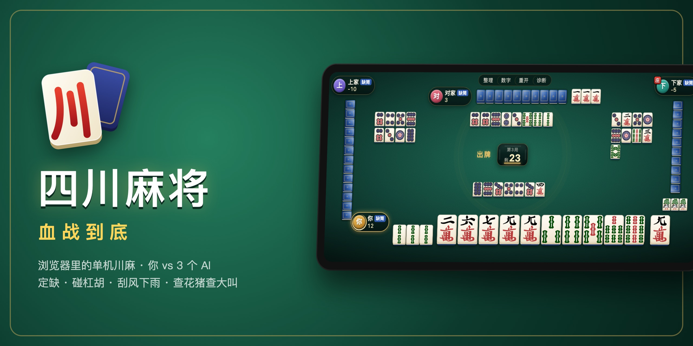

<p align="center"></p>

# 四川麻将 · 血战到底

浏览器里的单机四川麻将：你和 3 个电脑打一局血战到底。手机横屏、桌面浏览器都能玩，刷新页面后牌局接着打。

**在线试玩：<https://pages.epb.wiki/sichuan-mahjong/>**

## 规则

标准血战到底，不换三张：

- 只用万、条、筒 108 张；开局定缺，缺的那门打完才能胡
- 可以碰、明杠、暗杠、补杠，不能吃；胡牌后不退出，打到只剩一家或牌摸完
- 番型：对对胡、七对、清一色、金钩钓、根，加上自摸、杠上开花、杠上炮、抢杠胡、海底捞月；封顶 4 番
- 刮风下雨（杠钱），流局查花猪、查大叫，未听牌者退杠钱

## 操作

- 点一下手牌：选中，同时高亮场上所有同样的牌，看还剩几张
- 快速双击，或按住往上滑：打出这张牌
- 按住左右拖：调整手牌顺序（刚摸到的牌也能拖）
- 听牌时会提示能胡哪些牌、各还剩几张
- 顶部按钮：「整理」一键理牌，「数字」在牌角标出点数，「重开」放弃本局重新发牌，「诊断」复制本局完整记录

## 开发

需要 [Bun](https://bun.sh)。

```sh
bun install
bun dev          # 开发服务器
bun run build    # 构建到 dist/
```

推送到 `master` 后，GitHub Actions 会自动构建并部署到 GitHub Pages。

## 结构

```
src/engine/   规则引擎：纯 TypeScript，不依赖 DOM，可以在 bun 脚本里跑完整局
src/players/  玩家实现：人类（接 UI）、规则 AI
src/ui/       Vue 3 界面
```

每个座位都是一个 `Player`：

```ts
interface Player {
  decide(view: PlayerView, actions: Action[]): Promise<Action>
  onEvent?(event: GameEvent, view: PlayerView): void
}
```

引擎把这名玩家能看到的局面和当前合法动作交给 `decide`，玩家从中选一个返回；返回不合法的动作会直接报错。想换成别的 AI（比如接一个 LLM），实现这个接口，再替换 `src/ui/session.ts` 里 `lineup` 的对应座位即可。

## 致谢

牌面图案来自 [FluffyStuff/riichi-mahjong-tiles](https://github.com/FluffyStuff/riichi-mahjong-tiles)（CC0）。

## 许可证

[MIT](LICENSE)
